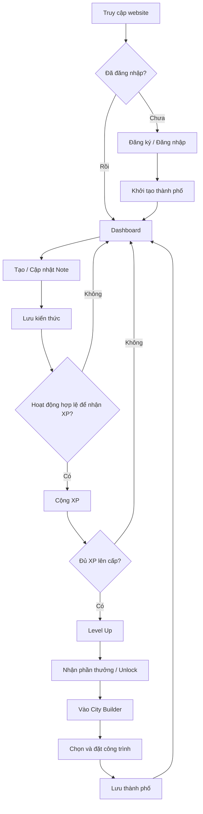
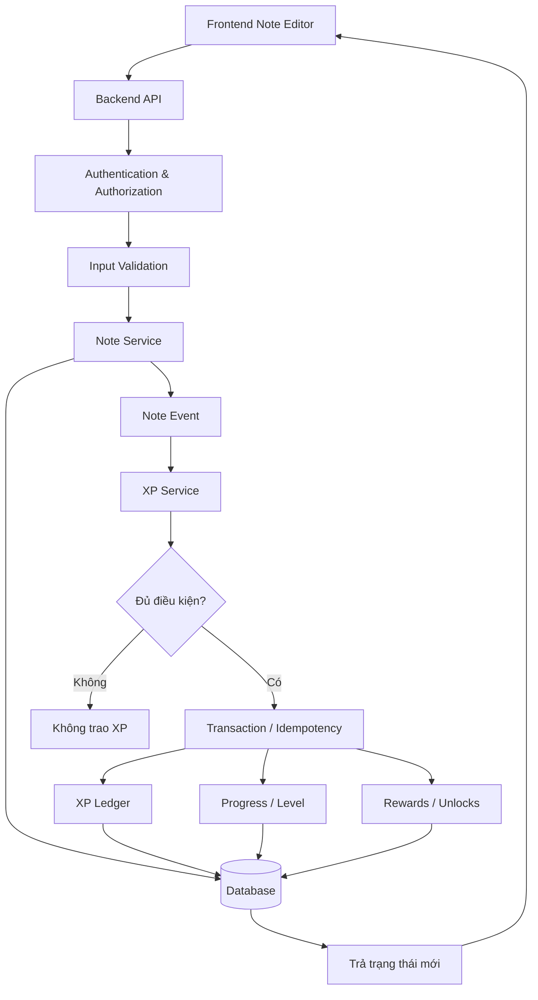
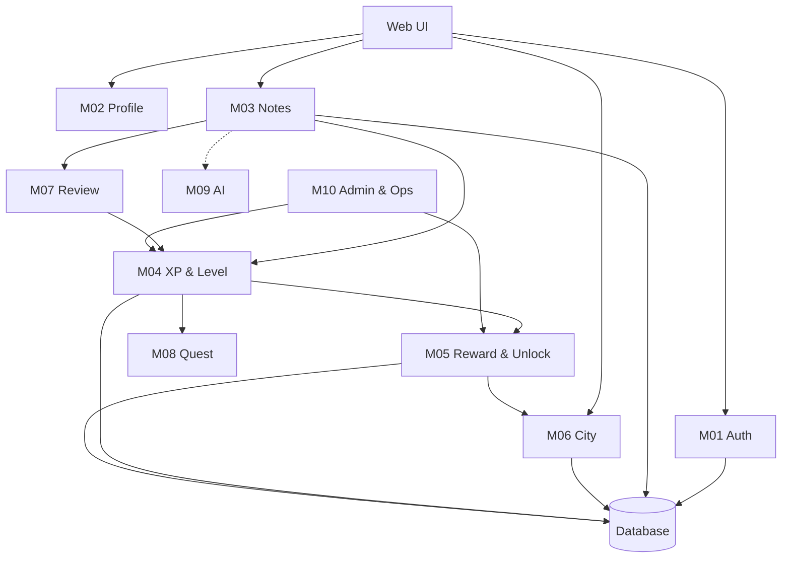
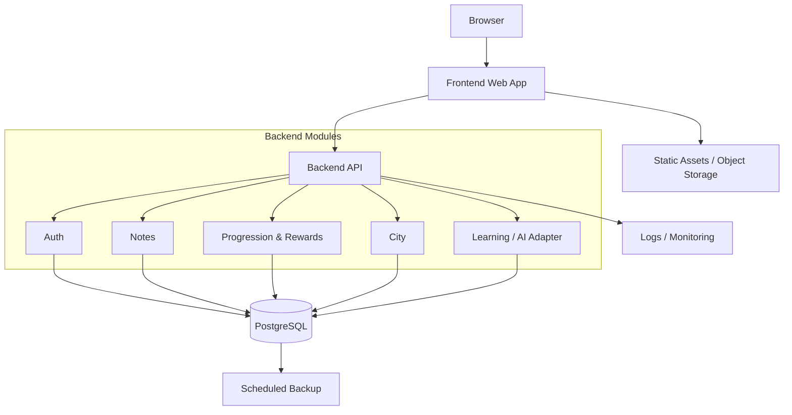
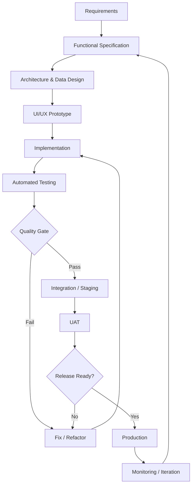

# KNOWLEDGE CITY — PRODUCT BLUEPRINT
## Bản đặc tả tổng quan ý tưởng, workflow, kiến trúc, gameplay, kiểm thử và triển khai

**Phiên bản:** 1.0 (bản định hướng)  
**Đối tượng:** Dự án website phục vụ cuộc thi ý tưởng, trọng tâm học sinh phổ thông  
**Phạm vi:** Toàn bộ sản phẩm website ghi chú kiến thức kết hợp xây dựng thành phố, không phải đặc tả triển khai riêng core building engine.  
**Mục tiêu:** Xác lập phạm vi sản phẩm, các module, quy trình phát triển, kế hoạch kiểm thử và điều kiện triển khai ổn định.

---

# 1. ĐỊNH NGHĨA Ý TƯỞNG SẢN PHẨM

## 1.1. Product vision
**Knowledge City** là nền tảng ghi chú kiến thức kết hợp cơ chế xây dựng thành phố. Mỗi người dùng có một thành phố cá nhân. Hoạt động ghi chú, tổ chức và ôn tập kiến thức tạo ra XP và tiến trình học tập, qua đó mở khóa công trình, vật trang trí và một số công cụ bổ sung.

Định hướng giá trị: biến tiến bộ học tập thành trải nghiệm trực quan, có tính cá nhân hóa và động lực duy trì thói quen.

## 1.2. Đối tượng mục tiêu
- Chính: học sinh phổ thông.
- Phụ: sinh viên và người tự học.
- Ngữ cảnh sử dụng: ghi chú theo môn/chủ đề, ôn tập và xem tiến trình phát triển thành phố.

## 1.3. Các trụ cột sản phẩm
| Trụ cột | Giá trị |
|---|---|
| Knowledge Notes | Tạo, tổ chức, tìm kiếm và quản lý ghi chú |
| Gamification | XP, level, milestone, phần thưởng |
| City Builder | Thành phố cá nhân biểu thị tiến trình |
| Learning Tools | Hỗ trợ ghi nhớ và ôn tập |
| Operations | Vận hành an toàn, theo dõi lỗi, sao lưu |

## 1.4. Nguyên tắc sản phẩm
1. Việc ghi chú phải hữu ích ngay cả khi người dùng không chơi game.
2. Học tập có chất lượng quan trọng hơn số lần bấm lưu.
3. Không khóa các chức năng thiết yếu như xem/sửa/xóa ghi chú, tìm kiếm cơ bản, bảo vệ dữ liệu.
4. Ưu tiên một vòng lặp gameplay hoàn chỉnh hơn nhiều tính năng chưa ổn định.
5. Mục tiêu không phải doanh thu, mà là giá trị giáo dục, tính sáng tạo và tính khả thi.

## 1.5. Phạm vi theo phiên bản
- **MVP:** tài khoản, notes CRUD, XP/level, unlock, inventory, city builder cơ bản, lưu và tải dữ liệu.
- **V1 dự thi:** hoàn thiện trải nghiệm, ôn tập cơ bản, thành tựu, giao diện trực quan, onboarding và QOL.
- **V2:** AI assistant, chia sẻ/tham quan thành phố, khu học tập theo môn, tính năng nâng cao.

---

# 2. WORKFLOW TỔNG QUAN

## 2.1. User workflow


**Core loop:** Ghi chú → XP → Level → Unlock → Xây thành phố → Quay lại học tập.

## 2.2. System workflow


**Quy tắc:** frontend chỉ gửi hành động. Backend xác định XP, level, phần thưởng và tính hợp lệ của thao tác.

## 2.3. Luồng ngoại lệ
- Request thất bại: hiển thị trạng thái thất bại và phương án thử lại.
- Gửi request trùng: không cộng XP hoặc cấp thưởng trùng.
- Hai tab sửa cùng dữ liệu: phát hiện/giải quyết xung đột.
- Lưu note thành công nhưng client mất kết nối: retry an toàn.
- Đặt công trình không hợp lệ: không thay đổi city state.

---

# 3. MODULE ARCHITECTURE

## 3.1. Danh sách module
| ID | Module | Chức năng | Giai đoạn |
|---|---|---|---|
| M01 | Identity & Authentication | Đăng ký, đăng nhập, session, quyền | MVP |
| M02 | User Profile | Hồ sơ và tùy chọn người dùng | MVP |
| M03 | Knowledge Notes | CRUD, phân loại, tìm kiếm, lưu nháp | MVP |
| M04 | XP & Level | Quy tắc XP, tính level, lịch sử | MVP |
| M05 | Reward & Unlock | Milestone, phần thưởng, quyền sở hữu | MVP |
| M06 | City Builder | Map, đặt/di chuyển/xóa công trình | MVP |
| M07 | Learning & Review | Ôn tập, flashcards, tiến trình học | V1 |
| M08 | Achievement & Quest | Thành tựu, nhiệm vụ | V1 |
| M09 | AI Learning Assistant | Tóm tắt, giải thích, trích xuất | V2 |
| M10 | Administration & Operations | Cấu hình, logs, backup, monitoring | MVP tối thiểu |

## 3.2. Module dependency


## 3.3. Trách nhiệm từng module
- **Auth:** quản lý danh tính, hash mật khẩu, session/cookie, quyền sở hữu dữ liệu.
- **Profile:** tên hiển thị, avatar/tùy chọn cá nhân.
- **Notes:** note editor, lưu nội dung, danh mục môn học, tag, tìm kiếm, phiên bản.
- **XP:** ghi sự kiện XP, chống trùng, giới hạn farm, tính level.
- **Rewards:** cấu hình mốc, cấp unlock và inventory; chống cấp trùng.
- **City:** bản đồ, placement, collision, persistence, đồng bộ giao diện.
- **Review:** các phiên ôn tập, đánh giá và tiến trình.
- **Quest:** mục tiêu học tập và phần thưởng.
- **AI:** lớp tích hợp tùy chọn, có quota và cơ chế kiểm soát đầu ra.
- **Admin/Ops:** cấu hình game, theo dõi lỗi, sao lưu, vận hành.

Các vấn đề bảo mật, logging, rate limiting, validation, monitoring là trách nhiệm xuyên suốt.

---

# 4. THIẾT KẾ LOGIC GAME

## 4.1. XP rules (tham khảo, cần playtest)
| Hành động | XP gợi ý | Điều kiện |
|---|---:|---|
| Tạo note hợp lệ | +20 | Đủ điều kiện nội dung, một lần |
| Hoàn thiện note | +10 | Thay đổi có ý nghĩa |
| Hoàn thành phiên ôn tập | +10 | Sự kiện xác nhận |
| Trả lời đúng câu ôn tập | +5 | Hợp lệ, không spam |
| Hoàn thành nhiệm vụ tuần | +50 | Đạt tiêu chí |

Không cộng XP vì nhấn Save liên tục, note rỗng, spam nội dung trùng, hoặc request lặp.

## 4.2. Level progression
Công thức ví dụ: `XP_next(L) = 100 + 25 × (L - 1)` với `L` là cấp hiện tại. Đây là XP bổ sung để đạt cấp kế tiếp, không phải tổng XP tích lũy.

Quy tắc bắt buộc:
- Có một nguồn sự thật cho XP và level.
- Xử lý trường hợp nhận XP vượt nhiều cấp.
- Không bỏ sót phần thưởng ở các mốc đi qua.
- Ghi lịch sử XP có event key để kiểm toán.
- Quyết định rõ chính sách khi note được sửa hoặc xóa.

## 4.3. Unlock progression mẫu
| Level | Mở khóa |
|---:|---|
| 1 | Nhà chính, map cơ bản |
| 2 | Nhà dân |
| 3 | Cây/vật trang trí |
| 5 | Thư viện nhỏ, note theme |
| 8 | Công viên |
| 10 | Flashcards |
| 15 | Khu phố mới |
| 20 | Xuất PDF |
| 25 | AI tóm tắt |

Đây là balance thử nghiệm, không phải quy định cứng. Nên mở sớm các công cụ học tập quan trọng; không khóa chức năng ghi chú thiết yếu.

## 4.4. City Builder rules cấp sản phẩm
- Grid-based placement.
- Mỗi công trình có catalog ID, footprint, asset và điều kiện sở hữu.
- Không đặt ra ngoài map, tile cấm hoặc chồng footprint.
- Backend xác thực ownership và placement.
- Di chuyển công trình phải giữ nguyên trạng thái cũ nếu vị trí mới không hợp lệ.
- Save/load tái tạo thành phố chính xác.
- Đảm bảo không tạo xung đột khi hai request cùng thay đổi map.

---

# 5. Ý TƯỞNG MỞ RỘNG GAMEPLAY

## 5.1. Subject District
- **Science District:** công trình phòng thí nghiệm, đài quan sát, bảo tàng khoa học.
- **Literature District:** thư viện, nhà sách, nhà hát.
- **Mathematics District:** kiến trúc hình học, học viện.
- Mục đích: trực quan hóa quá trình học theo lĩnh vực, không chỉ tổng XP.

## 5.2. Knowledge Buildings
- **Library:** mở bộ sưu tập note.
- **Academy:** truy cập flashcards/ôn tập.
- **Research Center:** truy cập công cụ AI (giai đoạn sau).
- Công trình vừa là phần thưởng vừa là điểm truy cập chức năng.

## 5.3. Gameplay expansion backlog
| Ý tưởng | Mô tả | Ưu tiên |
|---|---|---|
| Knowledge Tree | Sơ đồ kiến thức theo chủ đề | V1 |
| Daily Learning Quest | Nhiệm vụ nhẹ hằng ngày | V1 |
| Review-to-Repair | Ôn tập để cải tạo/nâng cấp công trình | V1 |
| City Milestone | Hoàn thành mốc học tập mở khu vực | V1 |
| Achievement Gallery | Trưng bày thành tựu | V1 |
| City Snapshot | Xuất ảnh thành phố | V1/V2 |
| Knowledge Festival | Sự kiện theo môn học | V2 |
| Visit Other Cities | Tham quan thành phố theo quyền riêng tư | V2 |

Không thiết kế cơ chế phạt quá nặng khi người học nghỉ vài ngày.

---

# 6. MUST-HAVE VÀ NICE-TO-HAVE

## 6.1. Must-have checklist
### Account & Security
- [ ] Đăng ký/đăng nhập/đăng xuất.
- [ ] Hash mật khẩu, session và bảo vệ route.
- [ ] Account A không thể truy cập dữ liệu của account B.

### Notes
- [ ] Tạo, đọc, sửa, xóa và tìm kiếm.
- [ ] Dữ liệu bền vững qua reload/đăng nhập lại.
- [ ] Trạng thái lưu rõ ràng; xử lý lỗi lưu thất bại.

### Progression
- [ ] XP đúng quy tắc và không trùng.
- [ ] Level tính đúng, kể cả vượt nhiều mốc.
- [ ] Reward và unlock chính xác, không cấp trùng.

### City
- [ ] Bản đồ và building catalog.
- [ ] Đặt/di chuyển/xóa công trình hợp lệ.
- [ ] Collision, ownership, save/load.

### Production
- [ ] Validation, error handling, logging.
- [ ] Automated tests cho luồng trọng yếu.
- [ ] Backup/restore, staging, release checks.

## 6.2. Nice-to-have / QOL
| Tính năng | Giá trị |
|---|---|
| Keyboard shortcuts | Ghi chú nhanh |
| Note templates | Chuẩn hóa cách ghi chú |
| Dark/Light mode | Cá nhân hóa |
| Advanced search/filter | Tìm kiến thức dễ hơn |
| Undo/Redo City | Sửa thao tác xây dựng |
| City presets | Lưu bố cục |
| Export/Import | Di chuyển/sao lưu ghi chú |
| Offline drafts | Giảm mất nội dung khi mất mạng |
| AI Note Assistant | Tổng hợp kiến thức |

Autosave, responsive cơ bản, trạng thái lưu và accessibility tối thiểu nên được xem là yêu cầu chất lượng sớm, không nên đợi unlock.

---

# 7. KIẾN TRÚC KỸ THUẬT

## 7.1. Architectural style
**Modular Monolith**: một backend thống nhất, phân chia module theo domain; không cần microservices ngay từ đầu.



## 7.2. Tech stack gợi ý
| Layer | Phương án |
|---|---|
| Frontend | Next.js + TypeScript |
| UI | Tailwind CSS + component library |
| Rich text | Tiptap |
| City renderer | Phaser hoặc PixiJS |
| Backend | Node.js + NestJS/Express |
| Database | PostgreSQL |
| ORM | Prisma/Drizzle |
| Auth | Auth.js hoặc giải pháp phù hợp |
| Tests | Vitest, Supertest, Playwright |
| CI/CD | GitHub Actions |
| Deployment | Frontend hosting + Node backend hosting |
| Ops | Logs, monitoring, health checks, backups |

## 7.3. Logical data model
- `users`: tài khoản.
- `profiles`: thông tin hiển thị.
- `notes`: nội dung, môn học, tag, thời điểm cập nhật.
- `progress`: total XP, level, version.
- `xp_events`: ledger, unique event key.
- `reward_rules`: điều kiện mở khóa.
- `unlocks`: quyền mở khóa của user, unique user/reward.
- `building_catalog`: loại công trình, footprint, asset.
- `inventory`: số lượng vật phẩm/công trình sở hữu.
- `cities`: map và version.
- `placed_buildings`: công trình đã đặt, tọa độ.
- `note_reviews`: lịch sử ôn tập.

Các index, unique constraints, FK và transaction cần được chốt ở thiết kế vật lý database.

## 7.4. API contract tối thiểu
| Method | Endpoint | Chức năng |
|---|---|---|
| POST | `/auth/register` | Đăng ký |
| POST | `/auth/login` | Đăng nhập |
| GET | `/notes` | Danh sách ghi chú |
| POST | `/notes` | Tạo note |
| PATCH | `/notes/:id` | Sửa note |
| DELETE | `/notes/:id` | Xóa note |
| GET | `/progress` | XP/level |
| GET | `/rewards` | Rewards/unlocks |
| GET | `/city` | Tải thành phố |
| POST | `/city/buildings` | Đặt công trình |
| PATCH | `/city/buildings/:id` | Di chuyển |
| DELETE | `/city/buildings/:id` | Thu hồi |

Mỗi endpoint cần authorization, validation và error contract rõ ràng.

---

# 8. QUY TRÌNH PHÁT TRIỂN TIÊU CHUẨN

## 8.1. SDLC


## 8.2. Bảy giai đoạn
1. **Discovery & Requirements:** PRD, user stories, MVP scope, success criteria.
2. **System & Game Design:** architecture, ERD, API spec, game rules.
3. **Foundation Setup:** repo, coding standards, environments, CI, migration, logging.
4. **Core Implementation:** phát triển theo module, test từng feature.
5. **Integration & QA:** E2E, security, performance, regression.
6. **Deployment & Release:** staging, migration, smoke, backup, rollback.
7. **Monitoring & Iteration:** phát hiện lỗi, thu phản hồi, lên backlog.

## 8.3. Thứ tự phát triển
Foundation → Auth → Profile → Notes → XP/Level → Reward/Unlock → City Builder → E2E Core Loop → Review → Achievements/QOL → AI → Release.

Mỗi tính năng cần acceptance criteria trước khi code; không tự ý mở rộng scope giữa sprint.

---

# 9. TEST STRATEGY VÀ TEST SET

## 9.1. Testing pyramid
- **Unit:** công thức XP, level, validation, collision.
- **Integration:** API, DB, transaction, authorization.
- **E2E:** các luồng người dùng thật.
- **Cross-cutting:** security, accessibility, performance, visual, deploy smoke.

## 9.2. Test case format
`Test ID | Requirement ID | Preconditions | Test Data | Steps | Expected Result | Actual Result | Status | Priority`

## 9.3. Bộ test khởi đầu
| ID | Module | Scenario | Expected | Priority |
|---|---|---|---|---|
| AUTH-01 | Auth | Đăng ký hợp lệ | Tạo tài khoản đúng | P0 |
| AUTH-02 | Auth | Email trùng | Không tạo trùng | P1 |
| AUTH-03 | Auth | Sai mật khẩu liên tục | Không truy cập; rate limit | P0 |
| AUTH-04 | Auth | Truy cập note của user khác | Backend từ chối | P0 |
| NOTE-01 | Notes | Tạo note hợp lệ | Lưu đúng | P0 |
| NOTE-02 | Notes | Nội dung rỗng/quá giới hạn | Validation đúng | P1 |
| NOTE-03 | Notes | Sửa note rồi reload | Khôi phục đúng | P0 |
| NOTE-04 | Notes | Mất mạng khi autosave | Không báo thành công giả | P0 |
| NOTE-05 | Notes | Hai tab sửa cùng note | Không âm thầm mất dữ liệu | P0 |
| XP-01 | XP | Tạo note hợp lệ | Trao XP một lần | P0 |
| XP-02 | XP | Gửi request đồng thời | Không nhân XP | P0 |
| XP-03 | XP | XP vượt nhiều cấp | Tính đủ level/rewards | P0 |
| XP-04 | XP | Transaction thất bại | Không trạng thái dở dang | P0 |
| XP-05 | XP | Xóa/sửa note đã nhận XP | Đúng chính sách đã chốt | P1 |
| RWD-01 | Reward | Đạt milestone | Unlock đúng | P0 |
| RWD-02 | Reward | Retry cấp thưởng | Không cấp trùng | P0 |
| CITY-01 | City | Đặt công trình hợp lệ | Lưu đúng tọa độ | P0 |
| CITY-02 | City | Collision | Từ chối, không đổi inventory | P0 |
| CITY-03 | City | Công trình chưa sở hữu | Từ chối | P0 |
| CITY-04 | City | Hai request cùng ô | Không xung đột dữ liệu | P0 |
| CITY-05 | City | Reload sau khi xây | Tải đúng map | P0 |
| E2E-01 | E2E | Đăng ký→Note→XP→Build | Hoàn thành core loop | P0 |
| DEP-01 | Deploy | Production build/migration | Thành công | P0 |
| DEP-02 | Deploy | Staging smoke | Các chức năng chính hoạt động | P0 |

## 9.4. Edge cases bắt buộc
- **Duplicate XP:** retry sau network timeout không nhân đôi XP.
- **Race condition:** hai tab đặt cùng ô chỉ một trạng thái hợp lệ.
- **Reward atomicity:** lỗi giữa chừng không gây mất/cấp trùng thưởng.
- **Account isolation:** IDOR bị chặn.
- **Multi-level XP:** không bỏ sót phần thưởng ở cấp trung gian.
- **Invalid save:** city data không hợp lệ không làm ứng dụng crash.
- **Cross-device:** cùng tài khoản tải đúng dữ liệu.

## 9.5. Feature-level test workflow
Ticket → Acceptance Criteria → Test Cases → Implementation → Unit/Integration → Review → Staging → E2E/Regression → Accepted.

**Definition of Done:** code đúng, UI states đầy đủ, validation/error handling, tests đạt, docs cập nhật và staging xác nhận.

---

# 10. PRODUCTION READINESS VÀ DEPLOYMENT

## 10.1. Môi trường
- **Development:** lập trình.
- **Test:** automated tests với dữ liệu độc lập.
- **Staging:** gần production về runtime, build, database và cấu hình.
- **Production:** người dùng thực.

Không dùng chung database production cho test có khả năng thay đổi dữ liệu.

## 10.2. Lỗi thường chỉ lộ khi deploy
| Rủi ro | Biện pháp |
|---|---|
| Env vars sai | Validate khi startup |
| Node version khác | Pin runtime và lockfile |
| Cookie/CORS/HTTPS | Test domain staging |
| Case-sensitive paths | CI Linux |
| Chưa chạy migration | Migration pipeline |
| Asset local-only | Static/object storage |
| Upload lưu đĩa tạm | Persistent storage |
| Latency | Retry, timeout, loading |
| Server restart | Không giữ state quan trọng trong RAM |
| Concurrent writes | Transaction, constraints, concurrency tests |

## 10.3. Release checklist
- [ ] Lint/typecheck/test/build đạt.
- [ ] Không còn P0 blocker.
- [ ] Migration được xác minh.
- [ ] Secrets không nằm trong repository.
- [ ] Auth, HTTPS, cookie, CORS đúng.
- [ ] Health check và DB connectivity đạt.
- [ ] Staging E2E smoke đạt.
- [ ] Backup và restore đã được thử.
- [ ] Logs/alerts hoạt động.
- [ ] Có rollback plan.
- [ ] Production smoke test sau deploy đạt.

## 10.4. CI/CD
Push/PR → Lint → Typecheck → Unit → Integration → Build → Staging → E2E/Smoke → Approval → Production → Health/Smoke → Monitoring.

Không đồng nhất "build thành công" với "website vận hành thành công".

---

# 11. PROJECT ROADMAP

## Milestone 1 — Requirements & Design
**Đầu ra:** PRD, user stories, MVP scope, GDD, ERD, API contract, test strategy.  
**Gate:** phạm vi, logic XP và quy tắc city không mơ hồ.

## Milestone 2 — Core Knowledge Platform
**Đầu ra:** Auth, Profile, Notes, tìm kiếm, persistence, bảo vệ dữ liệu.  
**Gate:** CRUD, quyền truy cập và test đạt.

## Milestone 3 — Progression & Rewards
**Đầu ra:** XP Ledger, level, milestone, unlock, inventory.  
**Gate:** không duplicate XP/reward, multi-level đúng.

## Milestone 4 — City Builder MVP
**Đầu ra:** map, catalog, placement, collision, persistence.  
**Gate:** hoàn thành E2E đăng ký→note→XP→build.

## Milestone 5 — Educational Value & Polish
**Đầu ra:** review/flashcards cơ bản, onboarding, QOL, responsive.  
**Gate:** người dùng thử nghiệm hiểu được core loop.

## Milestone 6 — QA & Release
**Đầu ra:** regression, security/performance, staging/UAT, deploy, monitoring.  
**Gate:** release checklist đạt và có rollback.

## 11.1. Ticket template
```text
Ticket ID:
Epic:
User Story:
Business Value:
Dependencies:
Functional Requirements:
Acceptance Criteria:
API / Data Changes:
UI States:
Edge Cases:
Test Cases:
Definition of Done:
```

Ví dụ `GAME-014 — Place Building`: người dùng sở hữu công trình, chọn tile hợp lệ, backend kiểm tra quyền và collision, lưu vị trí, reload vẫn đúng; test CITY-01..05.

---

# 12. HỆ THỐNG TÀI LIỆU DỰ ÁN

```text
project/
├── docs/
│   ├── product/
│   │   ├── PRD.md
│   │   ├── USER_STORIES.md
│   │   ├── MVP_SCOPE.md
│   │   └── USER_WORKFLOW.md
│   ├── game-design/
│   │   ├── GDD.md
│   │   ├── XP_BALANCE.md
│   │   ├── REWARD_SYSTEM.md
│   │   └── CITY_BUILDER_RULES.md
│   ├── architecture/
│   │   ├── SYSTEM_ARCHITECTURE.md
│   │   ├── MODULE_SPEC.md
│   │   ├── DATABASE_ERD.md
│   │   └── API_CONTRACT.md
│   ├── testing/
│   │   ├── TEST_STRATEGY.md
│   │   ├── TEST_CASES.md
│   │   ├── REGRESSION_CHECKLIST.md
│   │   └── RELEASE_CRITERIA.md
│   └── operations/
│       ├── DEPLOYMENT.md
│       ├── ENVIRONMENT.md
│       ├── BACKUP_RECOVERY.md
│       └── ROLLBACK_PLAN.md
├── client/
├── server/
└── README.md
```

- **PRD:** xây cái gì, vì sao.
- **GDD:** gameplay hoạt động thế nào.
- **Architecture/ERD:** module và dữ liệu liên kết thế nào.
- **API Contract:** frontend/backend trao đổi gì.
- **Test Strategy:** xác minh đúng bằng cách nào.
- **Deployment:** vận hành an toàn ra sao.

Các tài liệu là nguồn tham chiếu chính thức cho nhóm phát triển và coding agent; cập nhật khi có quyết định thay đổi.

---

# 13. TIÊU CHÍ ĐÁNH GIÁ SẢN PHẨM DỰ THI

## 13.1. Innovation
- Tích hợp ghi chú với thành phố có tiến trình trực quan.
- Cơ chế mở khóa tạo cảm giác thành tựu.
- Công trình liên kết chức năng học tập, không chỉ trang trí.

## 13.2. Educational Impact
- Khuyến khích ghi chú có cấu trúc và ôn tập.
- Không khuyến khích spam nội dung để farm XP.
- Có khả năng đo hiệu quả sử dụng thay vì chỉ đưa ra tuyên bố.

## 13.3. Technical Feasibility
- Kiến trúc hợp lý và dữ liệu nhất quán.
- Core loop vận hành thật.
- Có test tự động, staging, monitoring và backup.

## 13.4. User Experience
- Phù hợp học sinh phổ thông.
- Onboarding dễ hiểu.
- Ghi chú nhanh, thao tác xây dựng trực quan.
- Hoạt động ổn trên màn hình mục tiêu.

## 13.5. Chỉ số thử nghiệm gợi ý
- Tỷ lệ hoàn thành note đầu tiên.
- Tỷ lệ nhận XP và xây công trình đầu tiên.
- Thời gian hoàn thành onboarding.
- Tỷ lệ quay lại ôn tập.
- Lỗi nghiêm trọng trên mỗi phiên thử nghiệm.
- Phản hồi định tính về động lực học tập.

Các chỉ số chỉ là phương án đo; không tự kết luận tác động giáo dục khi chưa có dữ liệu.

---

# 14. TỔNG KẾT VÀ BƯỚC THỰC HIỆN

## 14.1. Bảy quyết định nền tảng
1. Notes là giá trị sử dụng nền tảng.
2. City Builder là điểm khác biệt chính.
3. XP/reward/city state do backend xác thực và quản lý.
4. MVP hoàn thiện core loop trước.
5. AI không phải điều kiện bắt buộc của MVP.
6. Kiểm thử được thiết kế song song với từng feature.
7. Staging, CI/CD và production readiness được chuẩn bị từ sớm.

## 14.2. Thứ tự bắt đầu
1. Chốt PRD và phạm vi MVP.
2. Chốt GDD: XP, level, unlock, city rules.
3. Chốt ERD, API contract, security.
4. Thiết lập repository, CI và môi trường.
5. Triển khai theo module với test.
6. Hoàn thiện demo ổn định.
7. Chạy staging/UAT và phát hành production.

## 14.3. Tiêu chí hoàn thành tổng thể
Người dùng có thể đăng ký, tạo và ôn tập ghi chú, nhận XP đúng, lên cấp, nhận công trình, xây thành phố, đăng xuất/đăng nhập lại hoặc đổi thiết bị mà vẫn giữ được dữ liệu và tiến trình. Các luồng trọng yếu có kiểm thử, hệ thống có khả năng phát hiện lỗi và phục hồi khi có sự cố.

**Lưu ý chất lượng:** Không có phương pháp nào bảo đảm tuyệt đối "zero bugs". Đích đến là không còn lỗi nghiêm trọng đã biết, kiểm soát rủi ro hồi quy và có cơ chế quan sát/khắc phục sau triển khai.

---
*Hết bản đóng gói 14 mục.*
